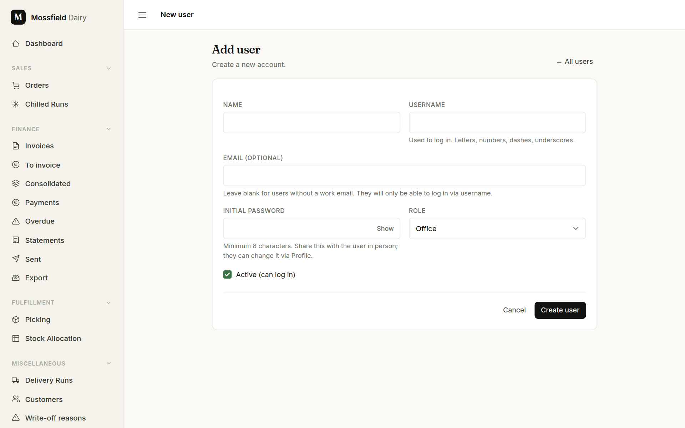
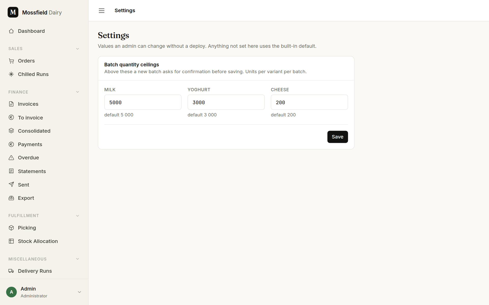
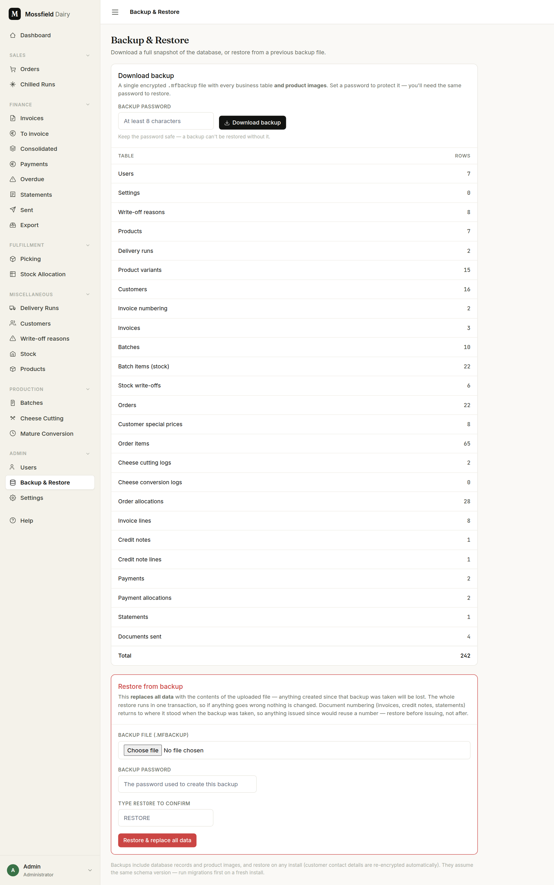

# Admin: users, settings, backup

For admins only. These three screens are under **Admin** in the sidebar, which only an administrator sees.

## Users

**Users** lists everyone who can sign in. Each person has one role:

- **Administrator**: everything, including these three screens.
- **Office**: everything except users, settings and backup: orders, the run sheet, finance, customers, production and stock.
- **Factory**: the packing floor. Picking on the phone, ticking stops as loaded, and reading orders, production and stock. Order prices and the finance screens are hidden from them.
- **Driver**: can sign in and change their own password; nothing else yet.

**Add user** opens the form.

- **Name** is what the app shows; **Username** is what they sign in with.
- **Email (optional)**: floor and van staff often have no work email. Without one, they sign in with the username only and cannot reset their own password; an admin sets a new one from **Edit**.
- **Initial password**: at least 8 characters. Give it to them in person; they can change it under Profile.
- **Role**, and **Active (can log in)**.

On the list, **Edit** changes a user. For someone who has left, use **Deactivate** rather than **Delete**: they are signed out at once on every device and can no longer sign in, and the account stays on record. **Reactivate** lets them back in. **Delete** removes the account for good.

- Changing someone's role also signs them out everywhere, so the new role takes effect straight away.
- You cannot change your own role or deactivate yourself; ask another admin.
- The last active administrator cannot be demoted, deactivated or deleted. There is always someone who can reach this screen.

## Settings

**Settings** holds values an admin can change without a new release. Anything not set here uses the built-in default.

**Batch quantity ceilings**: one number each for milk, yoghurt and cheese, in units per variant per batch. They are a check for typing slips, not a limit. A new batch with a quantity above the ceiling comes back once, asking for **Yes, this batch really is that big** to be ticked (see [Production](production.md)). Change a number and press **Save**; the message lists what changed.

Once a value has been changed, **Reset to defaults** appears and puts all three back.

## Backup & Restore

**Backup & Restore** saves the business data to one file, and can put it back.

**Download backup**: choose a **Backup password** and press **Download backup**. The file holds every business table (users, settings, products, customers, batches, orders, invoices, payments and the rest, listed with their row counts) and the product pictures, encrypted with that password. Keep the password safe: the file cannot be restored without it.

**Restore from backup** replaces all data with the file's contents. Read the warning on the page:

- Anything entered since the backup was taken is lost, including users and their passwords, which go back to how they were.
- Invoice, credit note and statement numbering goes back to where it stood, so anything issued since would reuse a number. Restore before issuing, not after.
- The restore runs in one go: if anything fails, nothing changes.

Choose the file, enter its password, type `RESTORE` and press **Restore & replace all data**.

A backup holds the data only. The server's own configuration (the email server, and the business and bank details printed on invoices) is not in it.
