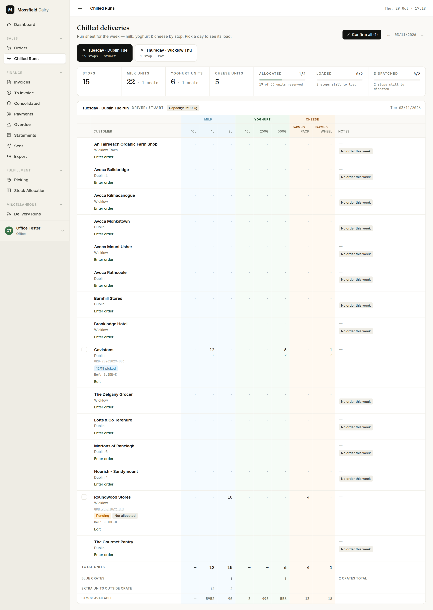
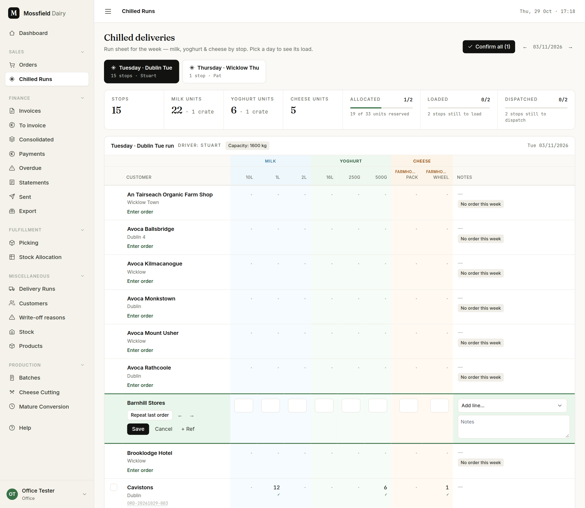

# Chilled runs

For the office. The run sheet is where the day's orders are entered, sent to the floor, given stock and sent out. It replaces the delivery spreadsheet.

## Pick the run and the week

Open **Chilled Runs** in the sidebar.

- The tabs along the top are the delivery runs (here "Tuesday · Dublin Tue" and "Thursday · Wicklow Thu"). Each shows its number of stops and its driver.
- The arrows beside the date move a week back or forward.
- The strip under the tabs totals the run: stops, milk, yoghurt and cheese units (with crates), and three progress bars for **Allocated**, **Loaded** and **Dispatched**.
- Each row is one stop, in delivery order. A stop with nothing ordered shows **No order this week**.

The working order for a run day is: enter the orders, **Confirm all**, **Allocate all**, let the floor pick, tick each stop loaded, **Dispatch run**.

## Enter each stop's order

1. Click **Enter order** under the shop's name (**Edit** if it already has an order). The row turns green and every column becomes a box.
2. Type the quantities. Milk and yoghurt columns are always there; cheese columns appear once a stop on the run orders that cheese.
3. **Repeat last order** fills in the shop's previous order. The ← and → arrows step back and forward through their last five orders, so you can start from any of them and change what is different.
4. **Add line…** (in the Notes column) adds a product that has no column yet.
5. **+ Ref** opens a box for the shop's purchase-order number. It opens by itself for shops that always need one.
6. Type anything the floor or the driver should know in **Notes**.
7. Click **Save**. The order is created as **Pending**. To change it later, click **Edit** again; setting every quantity to zero cancels it.

**Cancel** leaves the row without saving. If you click another row, a day tab or the week arrows with unsaved quantities, the sheet asks first: **Keep editing** goes back to the row, **Discard changes** throws the quantities away.

A stop with two orders for the same day cannot be edited on the sheet; its link opens the orders instead.

## Confirm all

**Confirm all** (top right, with the number of pending orders) confirms every pending order on the run for that day. They then appear in the floor's picking queue. If a shop is over its credit limit you get a warning, but the order still goes through.

## Allocate all

**Allocate all** reserves stock for every confirmed order on the run, oldest batches first. Pending orders are skipped; confirm them first. **Allocate** on a single row does the same for one stop.

Under each quantity a small line shows how much of it has stock:

| Mark | Meaning |
|---|---|
| ✓ | All of it is allocated |
| 4/10 | 4 of the 10 are allocated so far |
| 0/10 | Nothing allocated yet |
| 4/10 in red | Only 4 can be had: there is not enough stock |

The row's tag follows the order through the day: **Pending**, **Not allocated**, **Allocated**, "12/19 picked", **Ready**, **Dispatched**.

## The footer rows

| Row | What it counts |
|---|---|
| Total units | Units ordered in each column across the run |
| Blue crates | Full crates of milk or yoghurt |
| Extra units outside crate | Bottles or tubs left over after the full crates |
| Stock available | Free stock right now. A column turns red when the run still needs more than there is |

Cheese columns count units only; they have no crates.

## Loaded, then dispatch

1. As each stop goes on the van, tick the box at the left of its row. The floor can tick it too.
2. **Dispatch run** (with the number of orders it will send) dispatches every stop that is both **Ready** and ticked. For each one the customer is emailed a dispatch confirmation, and customers billed per order get their invoice issued (not emailed; send it from Finance).
3. Stops that are not picked or not ticked are left alone, and the message names each one and why, for example "skipped: ORD-… Shop B (not picked, not loaded)".

Once a stop is dispatched its tick is fixed and the row shows **Dispatched**.

See also: [Orders](orders.md) for one order at a time, [Picking](picking.md) for the floor's side.
