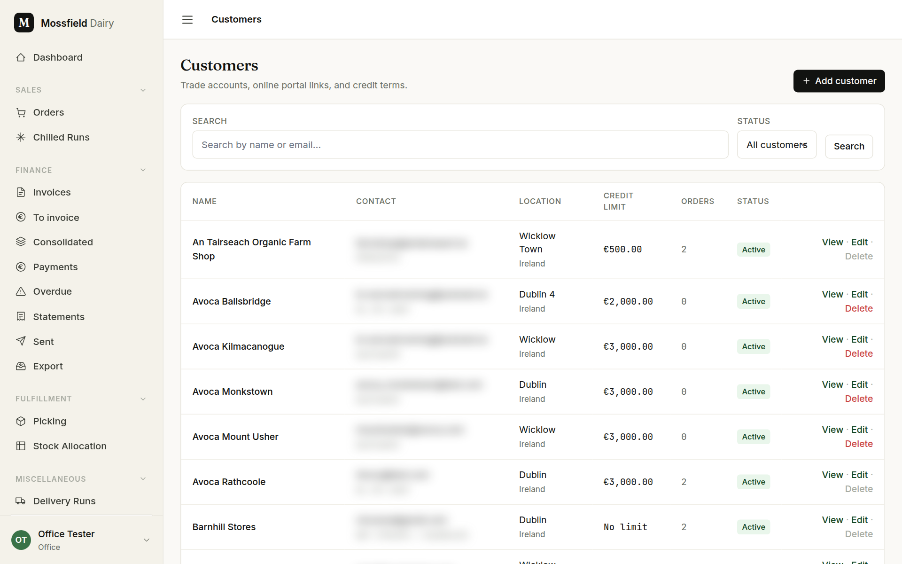
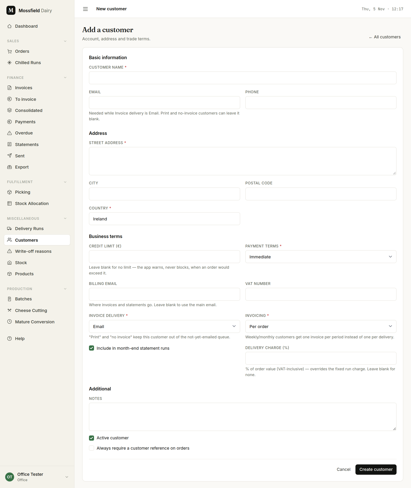
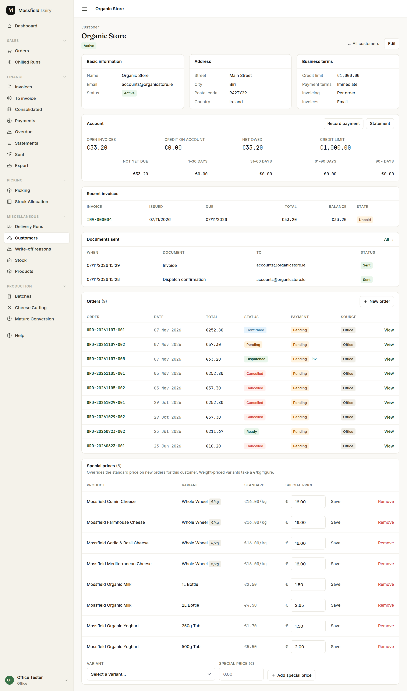
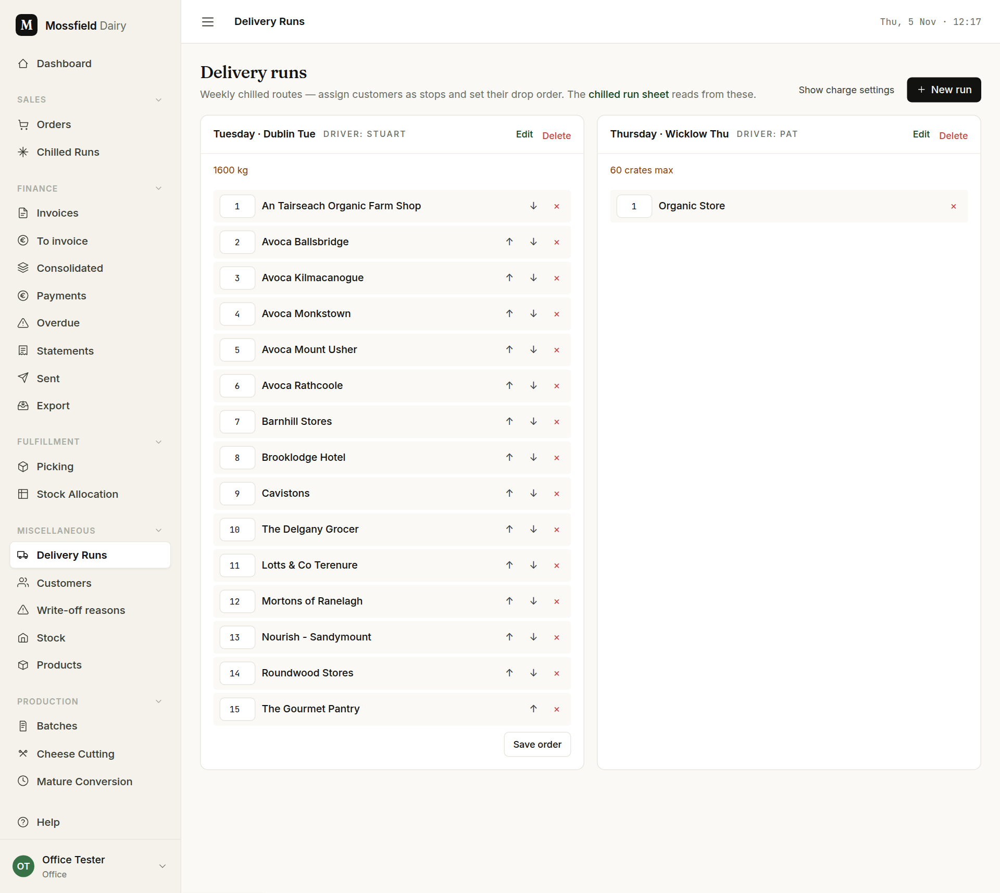

# Customers and delivery runs

For the office. A customer's terms, prices and delivery run are set once here, and every order then follows them.

## Find a customer

Open **Customers** in the sidebar.

- Type part of the name or email in **Search**; the list filters as you type.
- **Status** switches between all, active only and inactive only.
- **View** opens the customer page, **Edit** the form. **Delete** works only for a customer with no orders, invoices, payments, credit notes or statements; otherwise it is greyed out (point at it to see why), and the customer is set inactive instead.
- The *Credit limit* column reads "No limit" where none is set.

## Add or change a customer

Click **Add customer**, or **Edit** on an existing one. The form is in four groups.

**Basic information and Address**

- **Customer name** and **Street address** are required. **Phone**, **City** and **Postal code** can be left blank.
- **Email** is needed only while invoices go to the customer by email.

**Business terms**

- **Credit limit (€)**: leave blank for no limit. A limit warns, it never blocks. An order that would take the customer over it is still saved, with a warning naming what they owe and what the order takes it to. The same warning shows on the order page.
- **Payment terms**: Immediate, or net 7, 14 or 30 days. This sets the due date on each invoice.
- **Billing email**: where invoices and statements go. Blank uses the main email.
- **VAT number**: printed on their invoices.
- **Invoice delivery**: Email, Print / post, or No invoice sent. The last two keep the customer out of the *Not yet emailed* count in Finance.
- **Invoicing**: Per order bills each delivery when it is dispatched. Weekly or monthly bills one combined invoice for the period (see [Finance](finance.md)). Choosing weekly or monthly while the terms are Immediate moves the terms to Net 14 days; set them back if that is not what was agreed.
- **Include in month-end statement runs**: untick for a customer who should not get a monthly statement.
- **Delivery charge (%)**: for a customer who pays a percentage of each order for delivery, in place of their run's fixed charge. Leave blank otherwise.

**Additional**

- **Notes** are for the office.
- **Active customer**: untick instead of deleting a customer who has stopped ordering.
- **Always require a customer reference on orders**: the Customer ref box then opens by itself whenever you enter an order for them.

## The customer page

- *Basic information*, *Address* and *Business terms* show what the form holds.
- *Account* shows what is owed on open invoices, any credit on account, the net figure and how old the debt is. **Record payment** opens the payment form for this customer and **Statement** their statement. **Apply credit** appears when they have credit and an open invoice to put it against.
- *Recent invoices* and *Documents sent* appear once there is something to list.
- *Orders* lists every order, with **New order** to start one for this customer.

### Special prices

A special price is this customer's own price for one product, in place of the standard price.

1. Under *Special prices*, pick the **Variant**, type the **Special price (€)** and click **Add special price**. For cheese sold by the kilo the figure is per kilo.
2. To change one, edit the figure in its row and click **Save**. **Remove** goes back to the standard price.

A special price applies to order lines entered from then on. Orders already entered keep the price they were given.

## Delivery runs

A delivery run is a fixed weekly route. The [run sheet](chilled-runs.md) is built from these: one tab per run, one row per stop, in stop order. A customer is on one run at most.

Open **Delivery Runs** in the sidebar.

### Set up a run

Click **New run**, or **Edit** on a run.

- **Route name** and **Delivery day**. "Whole week (w/c)" is for a run with no fixed day.
- **Driver** and **Capacity note** are shown on the run sheet.
- **Tab order** decides where the run's tab sits on the run sheet.
- **Delivery charge (€, incl VAT)** is the fixed amount a stop on this run pays for delivery. Enter what the customer pays; the VAT is shown separately on the invoice.
- Untick **Active** to take the run off the run sheet without deleting it.

**Delete** removes the run. Its customers are kept; they are just no longer on a run.

### Stops

- **Add stop**: pick a customer who is not yet on a run and click **Add**. The box is not shown when every customer already has a run.
- Reorder with **↑** and **↓**, or type the positions you want in the boxes and click **Save order**.
- **×** takes a stop off the run. The customer is kept.

### Who pays the delivery charge

Click **Show charge settings**. Each stop then shows a switch, "€ charge: on" or "off", for whether that customer pays the run's fixed charge. A customer with a **Delivery charge (%)** shows their percentage here; change it on the customer form.

The fixed charge is added once per drop: one charge per customer per delivery date. A second order for the same day says the charge is already on the first. A percentage charge is worked out on every order.
