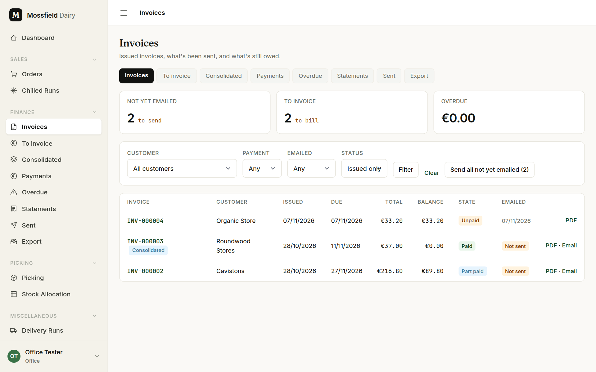
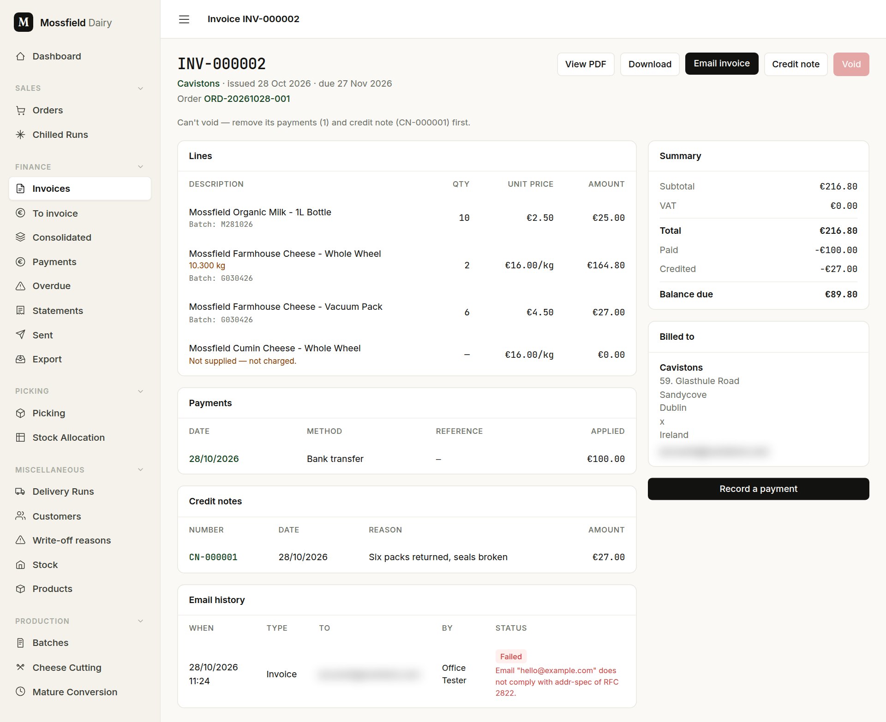
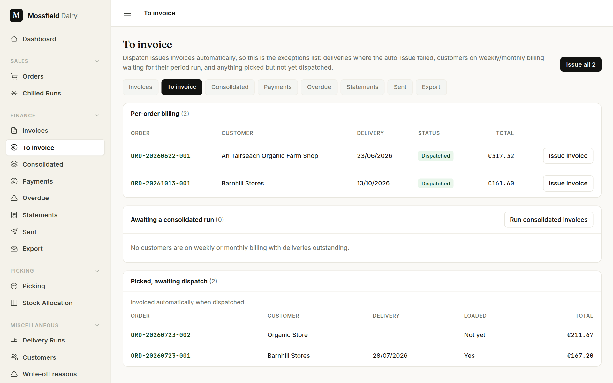
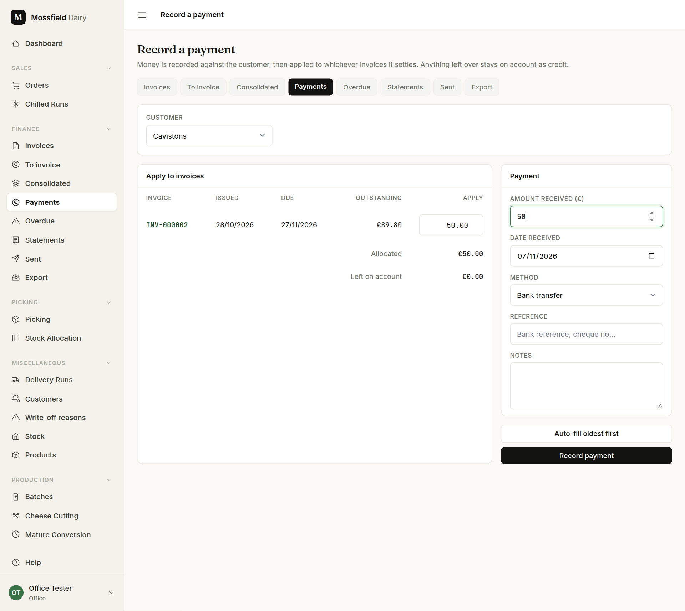
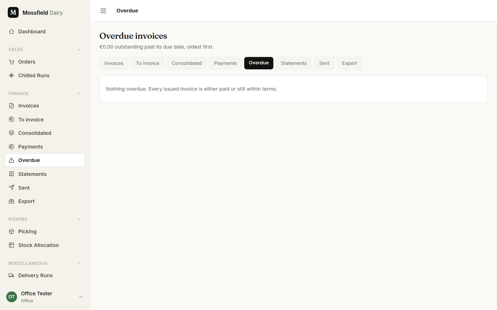
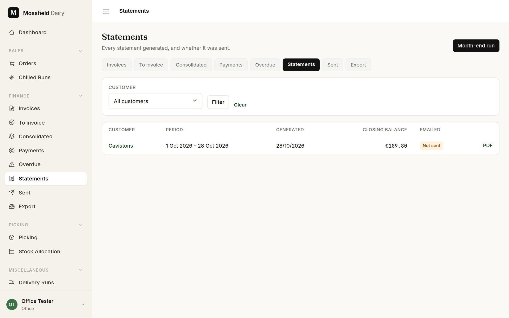
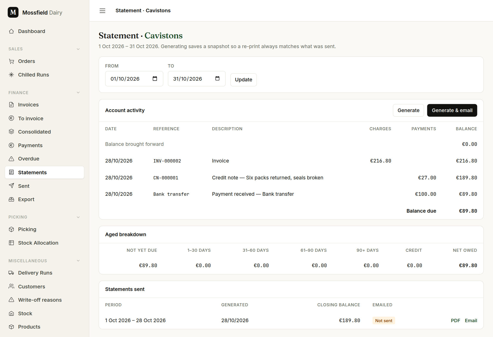
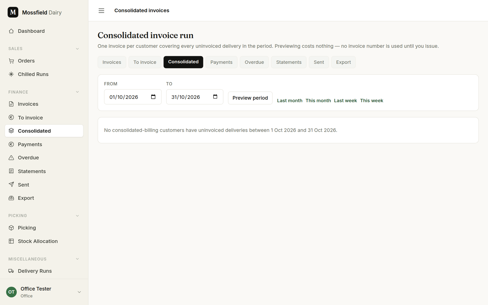
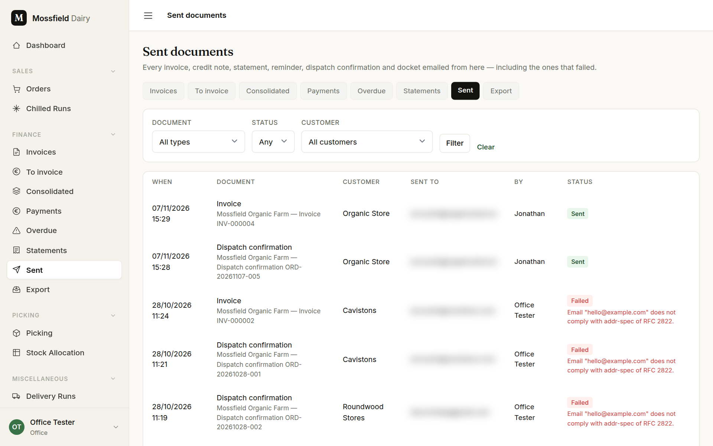
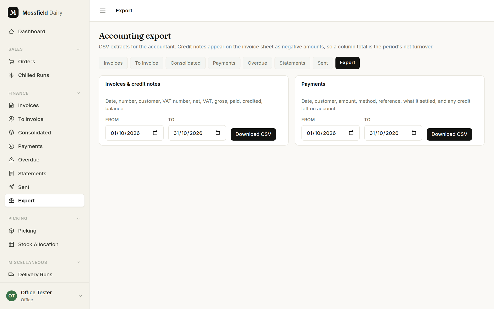

# Finance

For the office. The money side in the order you work it: what is invoiced when, sending invoices, recording payments, credit notes, chasing, statements and the export for the accountant.

## How invoicing works here

- **An invoice is a frozen copy.** When it is issued, every line, weight and price is copied from the order. Later changes to the order never change the invoice.
- **Dispatch issues it.** When an order is dispatched (**Mark dispatched** on the order, or **Dispatch run** on the run sheet), a customer billed per order gets their invoice automatically.
- **Weekly and monthly customers** are not invoiced at dispatch. Their deliveries wait for one combined invoice (see *Consolidated invoices*).
- **Nothing is emailed until you send it.** Dispatch emails the customer a dispatch confirmation, not the invoice.
- **An invoiced order is locked.** To change it, void the invoice, correct the order, and issue again.

The **Finance** group in the sidebar and the row of tabs across the top of every finance screen are the same eight screens: **Invoices**, **To invoice**, **Consolidated**, **Payments**, **Overdue**, **Statements**, **Sent**, **Export**.

## Invoices

The three tiles are the things to act on, and each is a link: *Not yet emailed*, *To invoice*, *Overdue*. Narrow the list with **Customer**, **Payment**, **Emailed** and **Status**, then **Filter**. Voided invoices are hidden until you choose Void under **Status**.

Click an invoice number to open it. Each row has **PDF**, and **Email** while the invoice is still to be sent. **Send all not yet emailed** at the top of the list sends every one of them in one go; they appear under **Sent** as they go.

- *Lines* is what was billed, with batch codes and picked weights. A line that was closed short reads "Not supplied — not charged."
- *Summary* shows the total, what has been paid and credited, and the **Balance due**. *Payments* and *Credit notes* list what makes those figures up.
- **View PDF** and **Download** give the document the customer gets.
- **Email invoice** sends it to the customer's billing address. Once sent, the button reads **Email again**. *Email history* at the bottom lists every attempt, with the reason if one failed.
- **Send reminder** appears once the invoice is overdue.
- **Credit note** starts a credit note against this invoice.
- **Void** cancels the invoice and asks for a reason. The invoice stays on file marked void, its number is not reused, and the order goes back to the *To invoice* list to be billed again. An invoice with a payment or a credit note against it cannot be voided: the button is greyed out and the line under the heading says what to remove first.
- **Record a payment** opens the payment form for this customer.

## To invoice

**To invoice** lists the orders still to be billed. Because dispatch issues invoices by itself, this is the exceptions list.

- *Per-order billing*: dispatched orders with no invoice, usually because the automatic one failed. **Issue invoice** bills one; **Issue all** bills every row.
- *Awaiting a consolidated run*: weekly and monthly customers with deliveries not yet billed. **Run consolidated invoices** takes you to that screen.
- *Picked, awaiting dispatch*: there are no buttons here. An invoice is only issued once the order has left, so these are invoiced when they are dispatched.

## Record a payment

Shops pay lump sums, so a payment belongs to the customer and is then spread over their invoices.

1. Open **Payments** and click **Record a payment** (or use **Record a payment** on an invoice, or **Record payment** on the customer page).
2. Pick the **Customer**. Their open invoices appear, oldest first.
3. Type the **Amount received (€)**. It is applied to the oldest invoices first as you type. Change any **Apply** box to split it differently; **Auto-fill oldest first** puts it back.
4. Fill in **Date received**, **Method** and, if you have one, the **Reference**.
5. *Left on account* is whatever is not applied to an invoice. It stays with the customer as credit.
6. Click **Record payment**.

Credit on account is spent later with **Apply credit** on the customer page, which puts it against the oldest open invoices. The button shows only when the customer has both credit and an open invoice.

A payment recorded by mistake is removed from its own page (**Remove payment**); the invoices it settled go back to outstanding.

## Credit notes

Use a credit note when part of an invoice should not be paid: returned goods, a wrong price.

1. On the invoice, click **Credit note**.
2. Type the amount to credit against each line it applies to and leave the others blank. The heading says how much can still be credited.
3. Give the **Reason**; it is printed on the credit note.
4. Click **Issue credit note**.

The invoice's balance drops by the credit. If the invoice had already been paid in full, the difference becomes credit on the customer's account. A credit note can be emailed, and voided, from its own page.

## Overdue

An invoice's due date comes from the customer's payment terms. Once that date has passed and money is still owed, it is listed under **Overdue**, oldest first.

When there are overdue invoices, each row shows the days late and when it was last reminded. **Remind** emails a reminder for one invoice, with the invoice attached; **Remind everyone** does it for every overdue invoice not already reminded today. A row reads "No email" when the customer has no address to send to. The *Overdue* tile on the dashboard counts the same list.

## Statements

A statement is a customer's account for a period: the balance brought forward, each invoice, credit note and payment, and the balance due, with an aged breakdown underneath.

For one customer, click **Statement** on the customer page (or the customer's name in the list above).

1. Set **From** and **To** and click **Update**.
2. **Generate** saves the statement so a reprint always matches. **Generate & email** saves it and sends it.
3. *Statements sent* lists earlier ones, each with its **PDF**.

For everyone at once, click **Month-end run**: choose the period and who gets one (customers with a balance, or customers with any activity), untick anyone to leave out, and click **Generate & queue**. The emails go out in the background; the run's page shows progress and offers a retry for any that failed. A customer is left out of these runs when **Include in month-end statement runs** is unticked on their form.

## Consolidated invoices

For customers whose **Invoicing** is weekly or monthly.

1. Open **Consolidated**. Set **From** and **To** and click **Preview period**, or use *Last month*, *This month*, *Last week*, *This week*.
2. Each customer with dispatched, unbilled deliveries in the period is shown with the lines their invoice would carry. Previewing uses no invoice number.
3. Untick anyone to leave out, then click **Issue selected**. Each customer gets one invoice covering the period.

## Sent

Every document emailed to a customer is listed here: dispatch confirmations, invoices, credit notes, reminders and statements, with who sent it and whether it was **Sent** or **Failed**. A failed row gives the reason. To try again, open the document and send it from there (for a dispatch confirmation, **Resend** on the order page).

## Export

Two CSV files for the accountant, each for the dates you choose: *Invoices & credit notes* (credit notes appear as negative amounts) and *Payments*. Set **From** and **To** and click **Download CSV**.

## What the invoice states mean

The state is worked out from the balance and the due date each time the invoice is shown, so it is never out of date.

| State | Meaning |
|---|---|
| **Unpaid** | Nothing paid or credited yet, and not past its due date |
| **Part paid** | Some money received, some still owed |
| **Credited** | Reduced by a credit note only; the rest is still owed |
| **Paid** | Nothing left to pay |
| **Overdue** | Money still owed after the due date |
| **Void** | Cancelled; kept on file, not owed |
