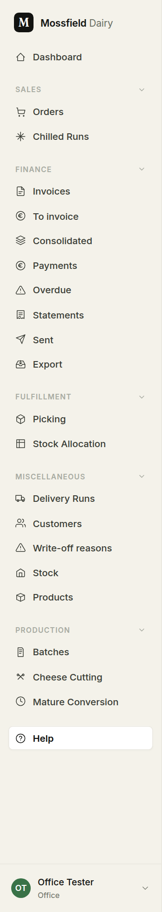
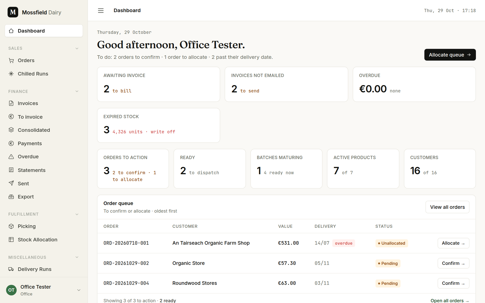

# Getting started

For everyone: how to sign in, what you will see, and where to find things.

## Sign in

1. Open the office system in a browser on the farm network.
2. Type your username (or your email address, if you have one on your account) in **Username or Email**, and your password.
3. Click **Log in**.

There is no sign-up page. An admin creates every account from **Users** and tells you your username and a first password. If you have forgotten your password and your account has an email address, use **Forgot your password?**; otherwise ask an admin to set a new one.

You can change your own name and password from your name at the bottom of the sidebar.

## What you see depends on your role

| Role | What it is for | Where you land |
|---|---|---|
| Admin | Everything the office does, plus users, settings and backups | Dashboard |
| Office | Orders, run sheets, customers, stock and finance | Dashboard |
| Factory | Picking orders on the phone, and looking up stock and batches | Picking queue |

Factory accounts can look at orders and stock but cannot change orders, customers or prices, and do not see any money. The picking screens show quantities and weights only.

## The sidebar

The sidebar groups the screens by job. Office users see all of these; factory users see the ones marked *floor*.

| Group | Screens |
|---|---|
| Sales | **Orders**, **Chilled Runs** (*floor*: both, read-only) |
| Finance | **Invoices**, **To invoice**, **Consolidated**, **Payments**, **Overdue**, **Statements**, **Sent**, **Export** |
| Fulfillment | **Picking** (*floor*), **Stock Allocation** |
| Miscellaneous | **Delivery Runs**, **Customers**, **Write-off reasons**, **Stock** (*floor*), **Products** (*floor*) |
| Production | **Batches**, **Cheese Cutting**, **Mature Conversion** (*floor*: all three) |
| Admin | **Users**, **Backup & Restore**, **Settings** (admins only) |

Click a group's name to fold it away. **Help**, at the bottom, opens this guide.

## The dashboard

The line under the greeting is the day's to-do list: orders to confirm, orders to allocate, and orders past their delivery date. The button beside it (**Allocate queue**) takes you to the first job.

The tiles count things that need doing. Each one is a link to the screen where you do it:

- **Awaiting invoice** and **Invoices not emailed**: finance work (see the Finance page, to come).
- **Overdue**: money owed past its due date.
- **Expired stock**: batches past their expiry date that still hold units. It appears only when there are some; write them off from the batch page.
- **Orders to action**: orders waiting to be confirmed or to have stock allocated.
- **Ready**: picked orders waiting for the van.

Below the tiles, the **Order queue** lists the orders to confirm or allocate, oldest first, each with a button for its next step (**Confirm** or **Allocate**). **View all orders** opens the full order list.

Factory users see a shorter dashboard with a **Picking queue →** button.

## Next

- [Orders](orders.md): entering, confirming, changing and sending out an order.
- [Chilled runs](chilled-runs.md): the run sheet the office works the day from.
- [Picking](picking.md): picking orders on the phone.
