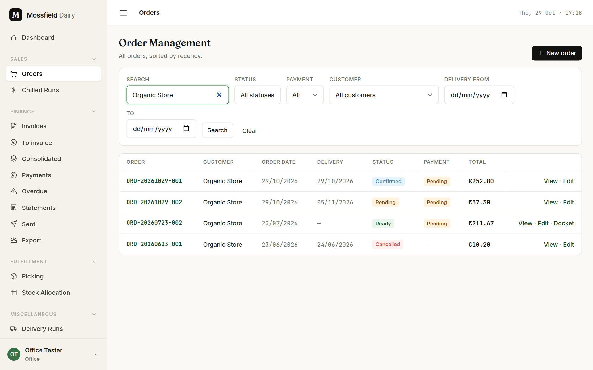
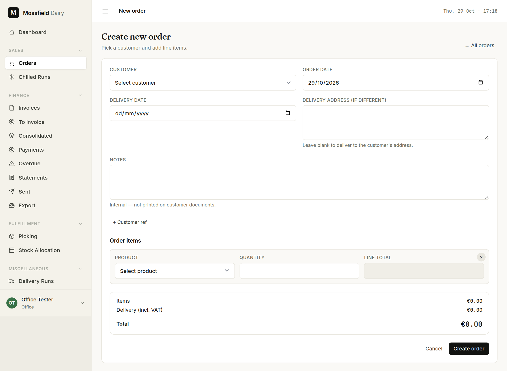
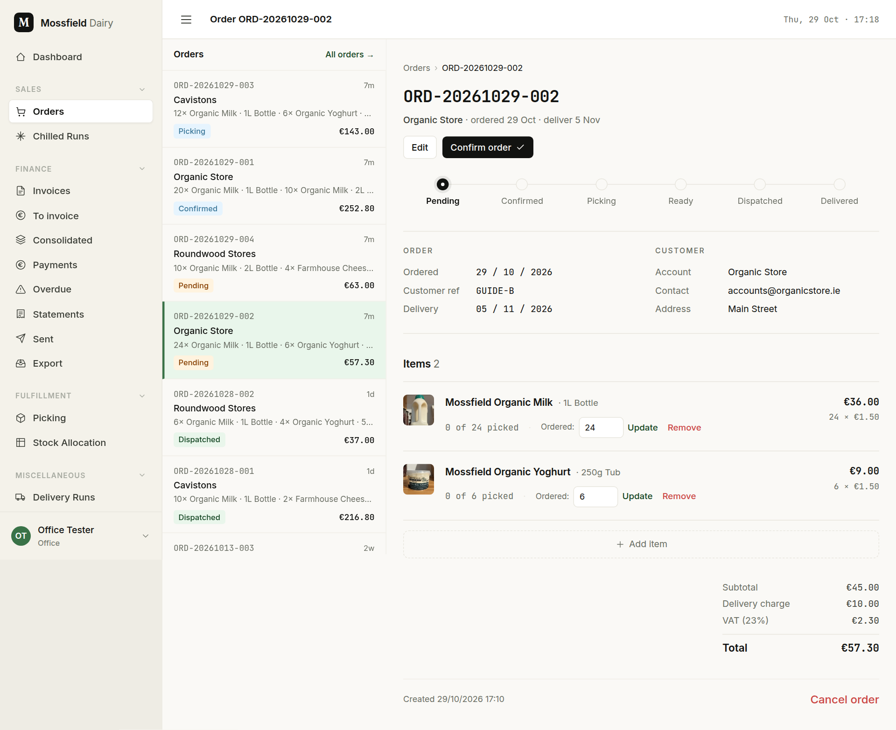
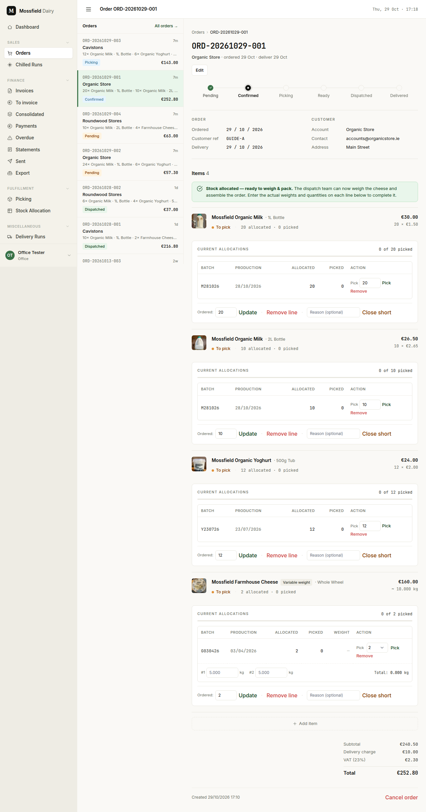
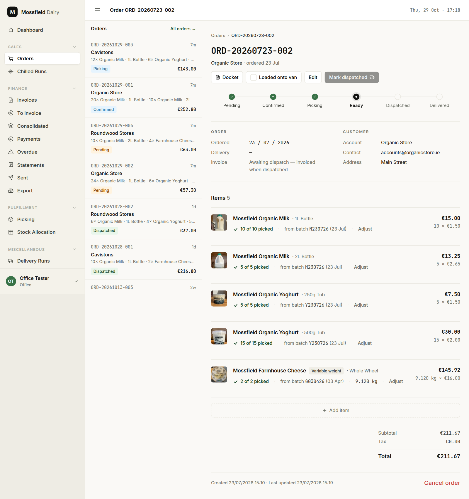

# Orders

For the office. Everything about one order happens on two screens: the order list and the order page.

## Find an order

Open **Orders** in the sidebar. The list shows every order, newest first.

1. Type part of the shop name, the order number or the customer's own reference in **Search**. The list filters as you type.
2. Narrow further with **Status**, **Payment**, **Customer** or a delivery date range (**Delivery from**) if you need to.
3. Click **View** on the row, or the order number, to open the order page.

**Clear** removes every filter.

## Enter a new order

Most orders are entered on the [run sheet](chilled-runs.md). Use this form for a one-off, or for a customer who is not on a delivery run.

1. On the order list, click **New order** and pick the **Customer**.
2. The **Delivery date** fills in with the customer's next run day, and the line under it names the run. A customer with no run gets "No delivery run — pick a date."
3. Add a line for each product: pick it, type the quantity. Prices are the customer's own (a special price if they have one).
4. Cheese sold by the kilo shows an estimate (`~`) based on the usual weight. The bill uses the weight actually picked.
5. **+ Customer ref** opens a box for the shop's own purchase-order number. It opens by itself for customers who always need one.
6. **Notes** are for the office and the floor only. They are never printed on anything the customer sees.
7. Click **Create order**. The order starts as **Pending**.

## Confirm, or cancel

A pending order is entered but not yet sent to the floor.

- **Confirm order** sends it to the picking queue and lets stock be allocated to it.
- **Cancel order** (bottom right) withdraws it. Any reserved or picked stock goes back to its batch. An order is never deleted; it stays on record as cancelled.

Confirm and cancel are the only status changes you make by hand. Everything after that follows from picking and dispatch.

## Allocate and watch the picking

On a confirmed order each line shows the stock reserved for it and how much the floor has picked.

- **Auto allocate** reserves stock for every line from the oldest batches first. (On the run sheet, **Allocate all** does the same for the whole run.)
- Each line's table shows the batch, how many are allocated and how many picked. **Remove** gives a reservation back.
- The floor normally picks on the phone (see [Picking](picking.md)). The **Pick** button on each row does the same from the office; for cheese, type each wheel's weight first.
- "0 of 20 picked" turns into a green tick when the line is done.

## Change an open order

Until an order is dispatched you can change its lines:

- **Add item** (under the lines) adds a product. If it is already on the order, the quantity is added to that line.
- Change the number in **Ordered** and click **Update** to change a quantity. Lowering it gives back any stock that no longer fits.
- **Remove** (pending) or **Remove line** (confirmed and later) takes a line off. Removing the only line cancels the order.
- **Close short** marks a line that cannot be filled: the missing units will not be supplied or billed, and the order can still go out. Add a reason if it helps. **Reopen** puts the line back into picking.
- On a picked line, **Adjust** opens the same controls.

An order with an invoice cannot be changed. Void the invoice in Finance first.

## Send it out

When every line is picked (or closed short) the order is **Ready**.

1. Print the **Docket** to go with the delivery. It has no prices.
2. Tick **Loaded onto van** once it is on the van. **Mark dispatched** stays grey until you do.
3. Click **Mark dispatched**. This:
   - emails the customer a dispatch confirmation: what went on the van, with weights and prices, marked "invoice to follow";
   - issues the invoice for customers billed per order. Weekly and monthly customers are billed later on their combined invoice.
4. The invoice is not emailed at this point. Send it from Finance.

For a whole run at once, use **Dispatch run** on the [run sheet](chilled-runs.md).

## What the statuses mean

| Status | Meaning |
|---|---|
| Pending | Entered but not yet sent to the floor. Confirm it to put it in the picking queue. |
| Confirmed | In the picking queue, nothing picked yet. |
| Picking | The floor has started on it. |
| Ready | Every line is picked or closed short. Waiting for the van. |
| Dispatched | Gone out. The invoice was issued at this point for per-order customers. |
| Delivered | Marked delivered by the office. |
| Cancelled | Withdrawn. Stock went back to the shelf. |
