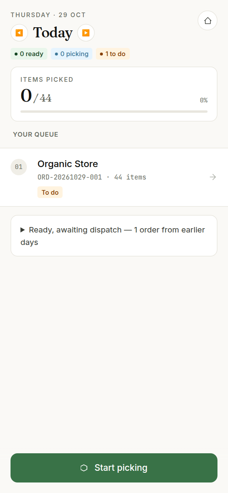
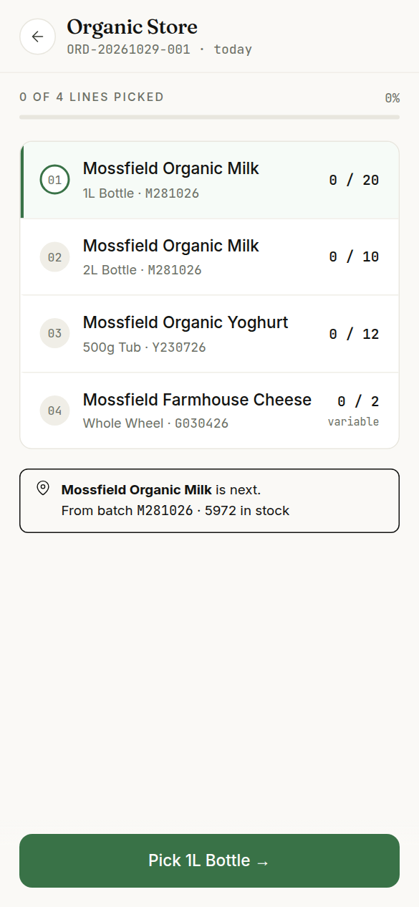
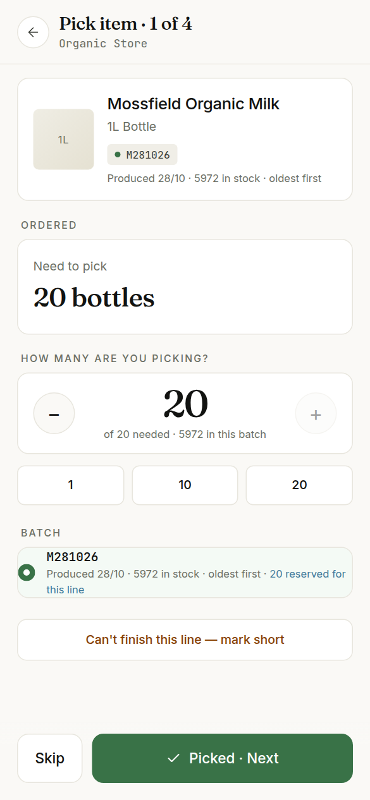
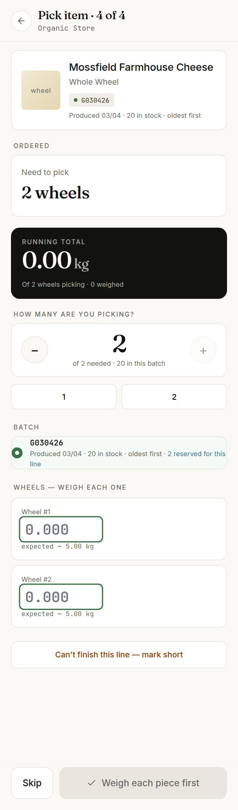
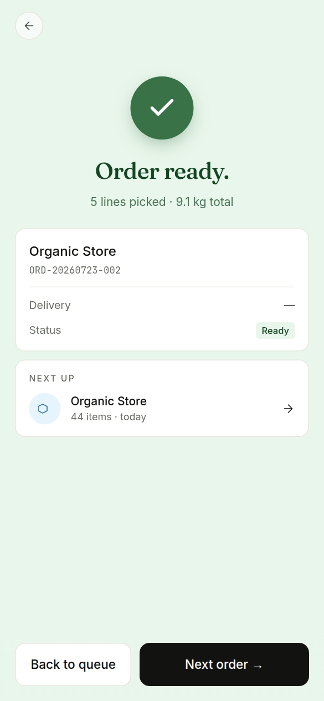
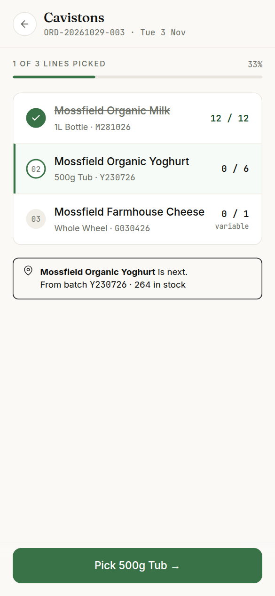

# Picking

For the packing floor. Picking is done on a phone: open **Picking** (factory accounts land there when they sign in), work down the queue, and the office sees each pick as you make it.

## The queue

- The queue shows one delivery day at a time, starting with today (or the next day that has work). The ◀ and ▶ arrows beside the day step to the previous or next day with orders.
- The coloured counts under the day say how many orders are ready, being picked and still to do. **Items picked** is the day's progress.
- Each order shows the shop, the order number and how many items it has, with its state: **To do**, a count such as "3/7 picked", or **Ready**.
- **Ready, awaiting dispatch** (folded, at the bottom) lists picked orders from earlier days that have not gone out yet. They are the office's to send, not yours to pick.
- The green button at the bottom is **Start picking** (or **Continue picking** if you have begun). It opens the next order to work on. You can also tap any order.

Only confirmed orders reach the queue. If a shop's order is missing, the office has not confirmed it yet.

## Open an order

The order page lists every line with how many are picked out of how many ordered, and the batch the stock comes from. The card under the lines says which line is next. Tap a line, or the button at the bottom, to pick it.

## Pick a line

1. **Need to pick** says how many the line wants.
2. Under **How many are you picking?**, use − and + or the quick buttons to set the number you are actually picking. It cannot go above what the chosen batch holds.
3. Under **Batch**, the oldest batch is chosen for you. Pick from another one only if the oldest is not to hand. A batch the office has already reserved for this line says so.
4. Tap **Picked · Next**. The next line opens.

**Skip** moves on to the next unpicked line without picking this one; it comes round again at the end.

If you picked fewer than the line wants, the rest stays on the line to pick later.

## Weigh cheese

Wheels are weighed one at a time. Each wheel gets its own box (Wheel #1, Wheel #2, …) showing the weight to expect. Type each wheel's weight in kilos; the **Running total** adds them up. The button reads **Weigh each piece first** until every wheel has a weight.

Vacuum packs are weighed together: put all the packs on the scale and type the one figure in **Total weight**. The button reads **Enter the weight first** until you do.

- A comma works as a decimal point: 4,85 becomes 4.85.
- A weight over twice the expected weight is tagged **Check**. Look again: it is usually a missed decimal point. A weight far too high is refused.
- Cheese is billed on the weight you enter, so it matters.

## When there is not enough stock

- If you can pick some but not all, tap **Can't finish this line — mark short** under the pick buttons.
- If there is no stock at all, the screen says **No available stock.** Tap **Mark short — no stock**.

Either way the missing units are taken off the order. They will not be supplied or billed, and any stock reserved for them goes back on the shelf. The order can then go out without them, and the office sees it marked "Supplied short". A short line can be put back with **Reopen line** if stock turns up.

## Undo a pick

Open the line again. A picked line shows what was picked and from which batch; **Undo last pick** puts the stock back in its batch and the line back in the queue.

## Done

When every line is picked the order shows **Order ready.** on green: it is ready for the van. If any line was marked short, it says **Order closed — short.** on amber instead, and lists the short lines (tap one to reopen it).

**Next order** opens the next order in the queue; **Back to queue** returns to the list.

A half-picked order looks like this: the picked line is ticked and struck through, and the next line is highlighted.
