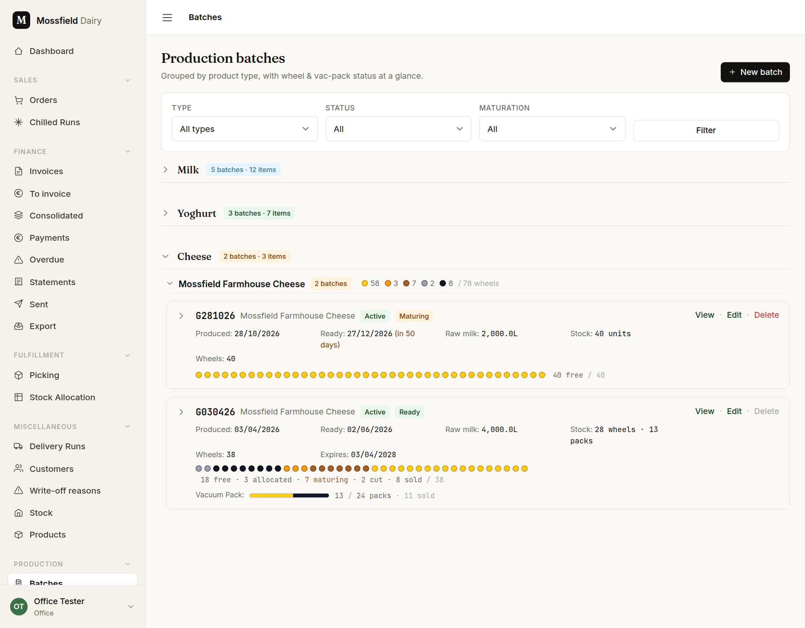
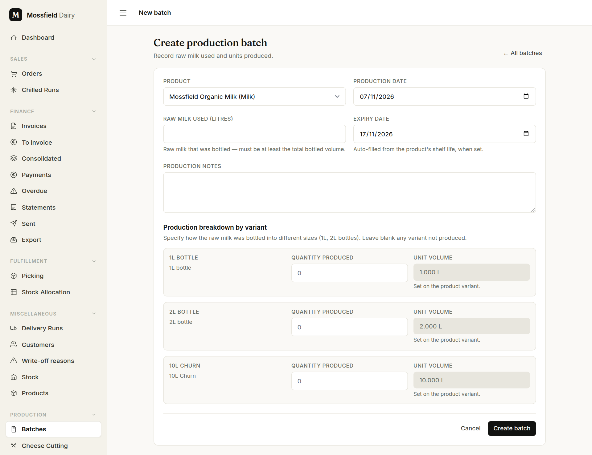
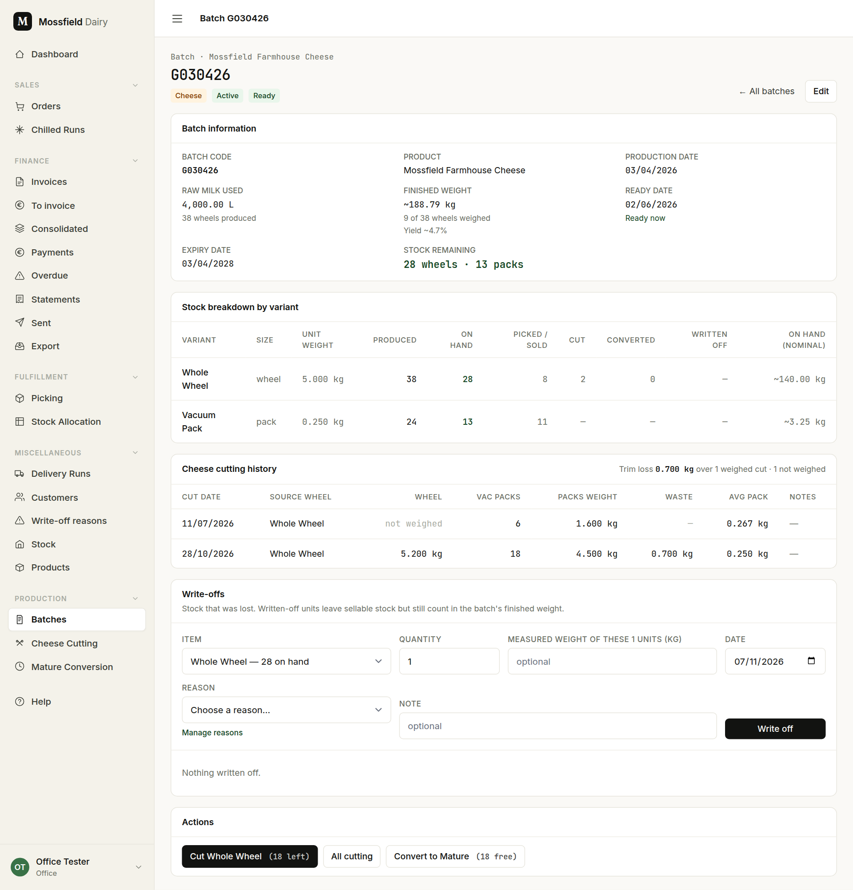
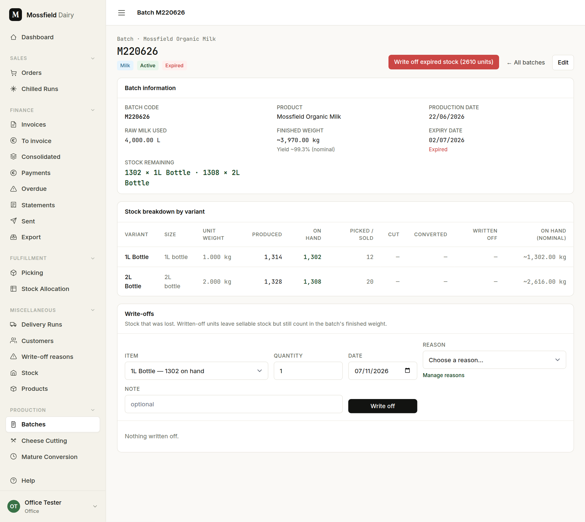
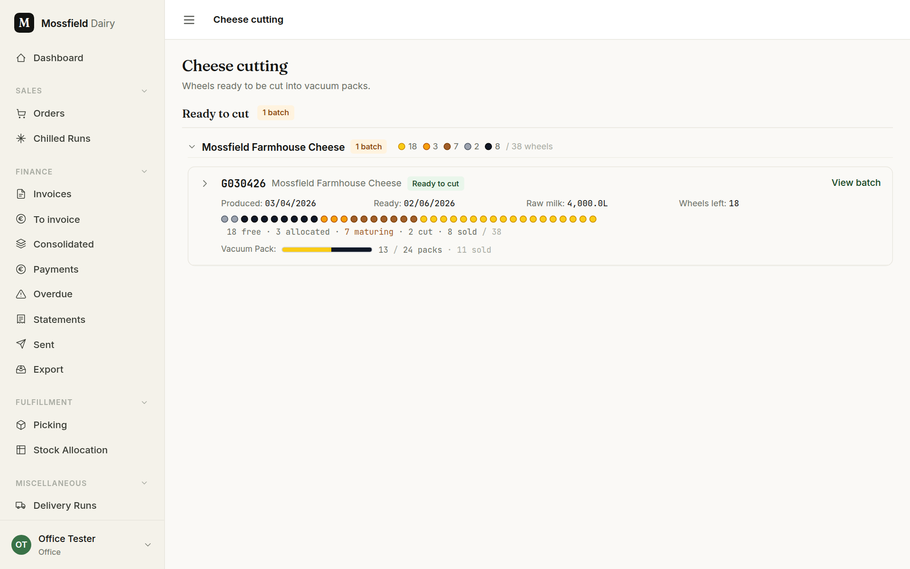
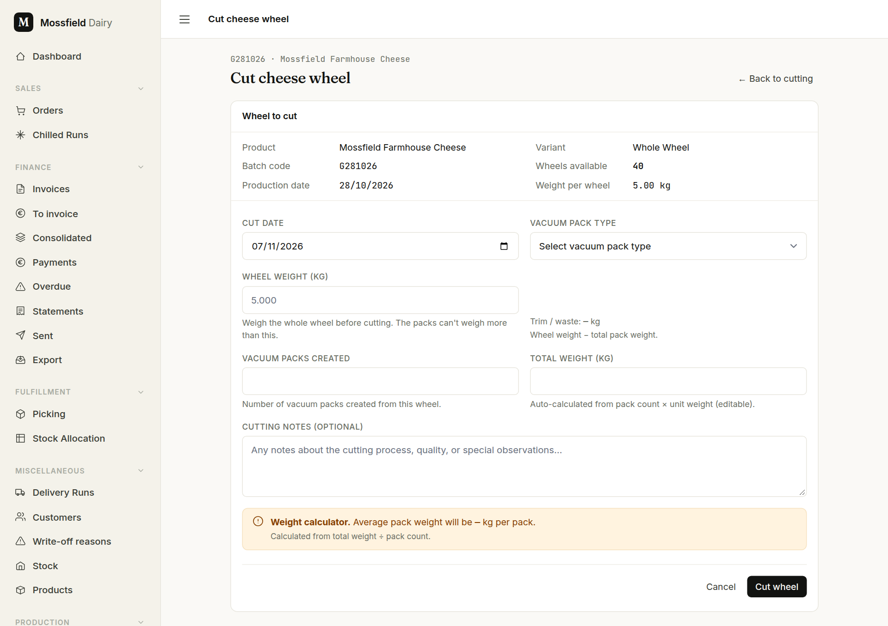
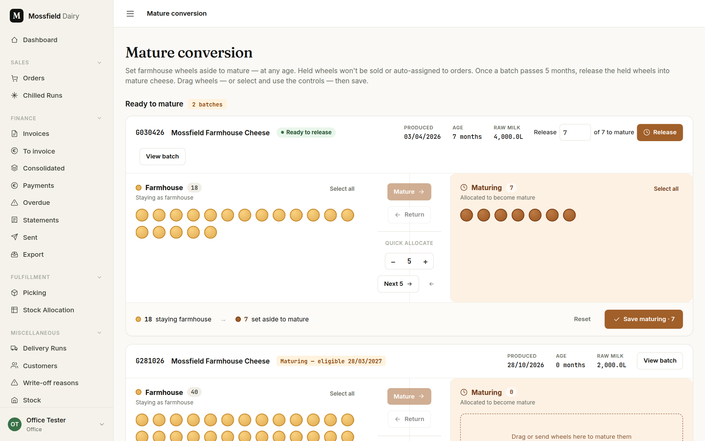

# Production: batches, cutting and maturing

For the office and the floor. The floor can read every screen on this page; the office records, cuts, writes off and matures.

## What a batch is

A batch is one make: one day's milk, yoghurt or cheese. Its code is the type letter and the production date:

- **M** for milk, **Y** for yoghurt, **G** for cheese, then day, month and year: `M071126` is milk made on 7 November 2026. A second batch of the same type on the same day gets `-1`, `-2` on the end.
- A batch has one line per variant: so many 1L bottles, so many 2L bottles; so many whole wheels.
- Stock can be sold while the batch is active and before its expiry date. A batch that expires today is already out of stock everywhere.
- Cheese has a ready date as well (the production date plus the product's maturation days) and is not sold before it.

## Find a batch

Open **Batches** in the sidebar. Batches are grouped by type (Milk, Yoghurt, Cheese) and cheese again by variety; click a heading to fold it away.

- **Type**, **Status** (Active, Sold out, Expired) and **Maturation** (Ready to sell, Still maturing) narrow the list; press **Filter**.
- Each cheese card shows one dot per wheel made:
  - yellow: free to sell
  - amber: allocated to an order
  - deep amber: on a maturing hold (see *Maturing* below)
  - grey: cut into vacuum packs
  - black: sold
  - purple: converted to Mature cheese
  - red: written off
- Under the dots, the same in words: "18 free · 3 allocated · 7 maturing · 2 cut · 8 sold / 38". The vacuum packs get a bar instead: yellow left, black sold.
- The variety heading totals the dots across its batches, so the picture stays when the cards are folded.
- A Mature batch says which farmhouse batch it was **Matured from**; a farmhouse batch that has fed one says **Matured into**.
- **Expired** in the Status filter lists every batch past its date that still holds stock. The dashboard's *Expired stock* tile links here. An expired card with stock carries **Write off →**.

## Record a batch

Click **New batch**.

1. Choose the **Product**. The form then lists its variants, one quantity box each. Leave blank any variant not made.
2. **Production date** is today unless you change it. **Expiry date** fills itself from the product's shelf life (milk: ten days); a product with no shelf life says so, and its batch never expires unless you enter a date.
3. **Raw milk used (litres)**: for milk, the bottles cannot add up to more than this. The form refuses with "Bottled N L is more than the M L of raw milk entered."
4. **Create batch**.

A quantity far above the usual size is refused once, in case of a typing slip: the form comes back with "That batch is much bigger than usual — check the quantities, or confirm it." Tick **Yes, this batch really is that big** to save it as it is. The limits are set by an admin (see [Admin](admin.md) *(admins)*).

Cheese wheels are recorded here; vacuum packs are made later by cutting.

## The batch page

Click **View** on a batch's card.

- **Batch information**: the dates, the raw milk, the stock remaining and the **Finished weight** with its **Yield** (finished weight against raw milk). Where wheels were weighed, when picked or before cutting, their real weight counts; the rest count at the nominal weight. When not every wheel has been weighed, the figure starts with `~` and says how many were, "9 of 38 wheels weighed".
- **Stock breakdown by variant**: for each variant, produced, on hand, picked / sold, cut, converted and written off. *On hand (nominal)* is the weight of what is left at the nominal weight; stock on the shelf has not been weighed.
- **Cheese cutting history**: each cut, the wheel's weight, the packs and the trim.
- **Write-offs**: see the next section.
- **Actions**: **Cut Whole Wheel (N left)** opens the cut form; N counts free wheels only, not those allocated or held. **Convert to Mature** opens the maturing screen.

**Edit** changes the batch's details. **Delete** sits on the batch's card in the list, and works only while nothing depends on the batch: no order allocations, cuts, conversions or write-offs. Otherwise it is greyed out; point at it to see why. To take such a batch out of circulation, set its status to sold out or expired instead (**Edit**).

## Expired stock and write-offs

Stock that is lost (spoiled, dropped, used as samples, expired) is **written off**. It leaves sellable stock but still counts in the batch's finished weight, because it was made.

On the batch page, in **Write-offs**:

1. Choose the **Item** (the variant and how many are on hand) and the **Quantity**.
2. For cheese, enter the measured weight of those units if you have it (optional).
3. Choose a **Reason**, add a **Note** if useful, check the **Date**.
4. **Write off**.

- Units reserved for orders cannot be written off. The form refuses with the number reserved; release them from the orders first.
- Wheels on a maturing hold can be. The hold shrinks to match, and the message says so.
- On an expired batch, the red **Write off expired stock (N units)** at the top writes off everything that can be in one go, with the reason *Expired*. Reserved units stay, and the message names them.
- **Reverse** on a past write-off puts the units back into free stock. The row stays in the list, marked reversed.
- The list of reasons is kept under **Write-off reasons**; see [Stock](stock.md).

## Cutting a wheel

Open **Cheese Cutting**. It lists the cheese batches with free wheels to cut ("Ready to cut").

Click **Cut wheel**. The form shows the batch and how many wheels are available.

1. Weigh the whole wheel before cutting and enter the **Wheel weight (kg)**.
2. Choose the **Vacuum pack type** and enter **Vacuum packs created**. **Total weight (kg)** fills in from packs × pack weight; correct it to the weighed total.
3. *Trim / waste* shows the difference: wheel weight less the packs. The weight calculator shows the average pack weight.
4. **Cut wheel**.

The form refuses packs that weigh more than the wheel, more packs than the wheel could make at the pack's nominal weight, and a cut date before the batch was made or after today. The packs join the same batch, so each pack traces back to its wheel and its make.

## Maturing

Mature cheese is Farmhouse cheese left to age. It happens in two steps on **Mature Conversion**.

**1. Set wheels aside.** Each Farmhouse batch has two zones, *Farmhouse* and *Maturing*. Move wheels across by dragging them, by selecting them and pressing **Mature →** / **← Return**, or with the quick-allocate stepper. Then press **Save maturing**.

- It works at any age, and it can be undone: move wheels back and save again.
- Held wheels stay in the Farmhouse batch but are no longer offered to orders, to picking or to cutting.

**2. Release them.** Once a batch is old enough (about five months), the card says *Ready to release*. Enter how many of the held wheels to release and press **Release**.

- The wheels leave the Farmhouse batch and become Mature cheese, in one Mature batch per Farmhouse batch. The Mature batch keeps the original production date, so it can be sold at once.
- A younger batch shows the date it becomes eligible: "Maturing — eligible 28/03/2027".

Released by mistake? On the Mature batch's page, **Return to farmhouse hold** sends the wheels back to the Farmhouse batch's hold. It is offered only while all those Mature wheels are still free: none cut, sold or allocated to an order.

See also: [Stock](stock.md) for the stock overview and products.
