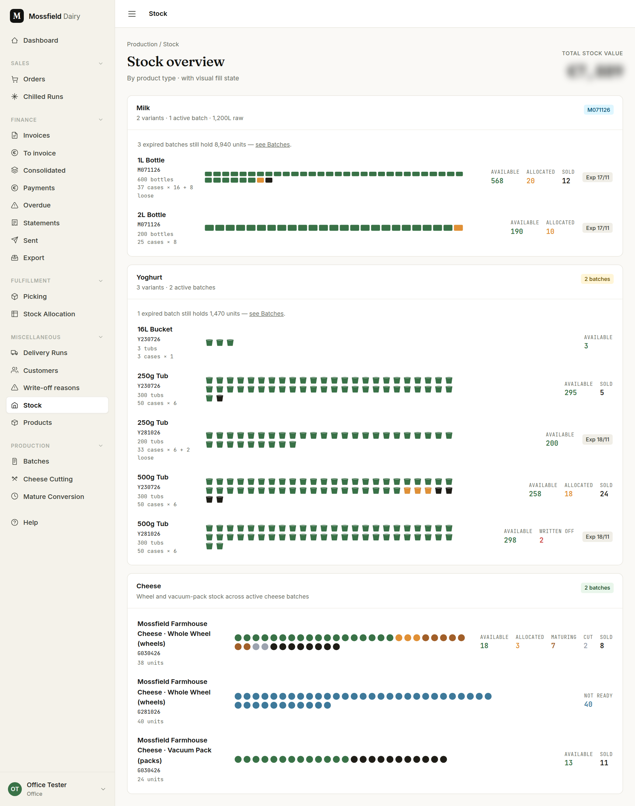
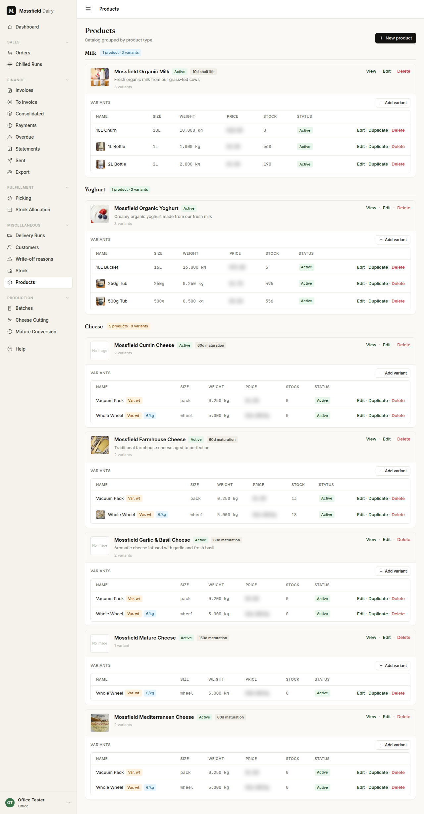
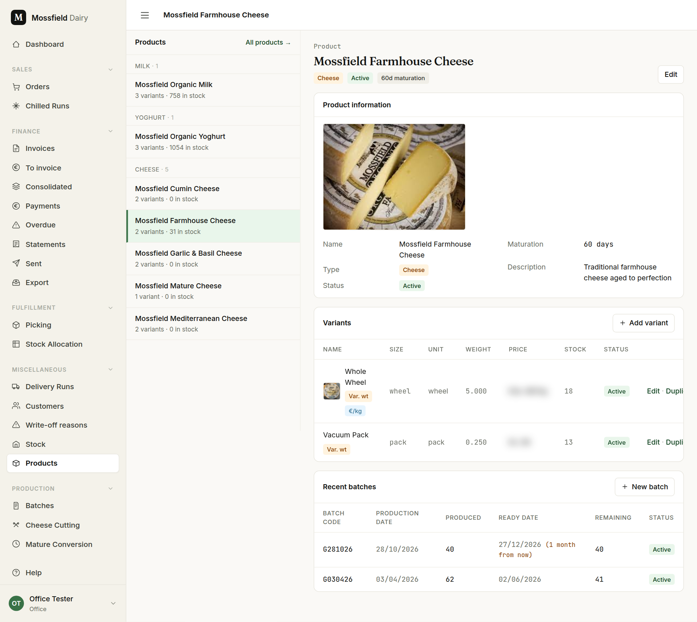
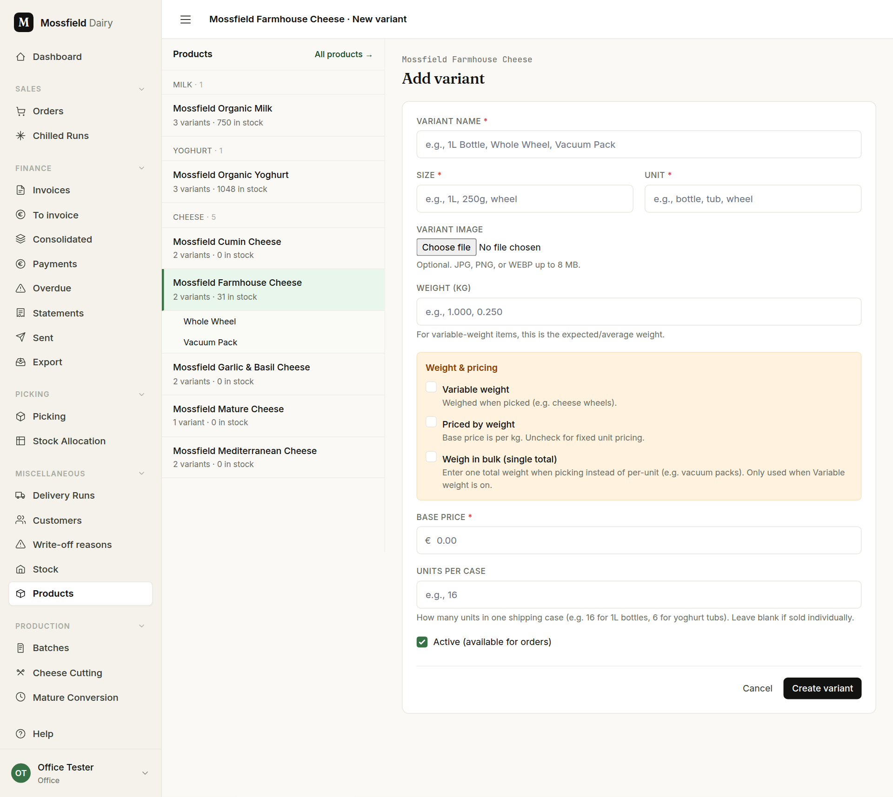
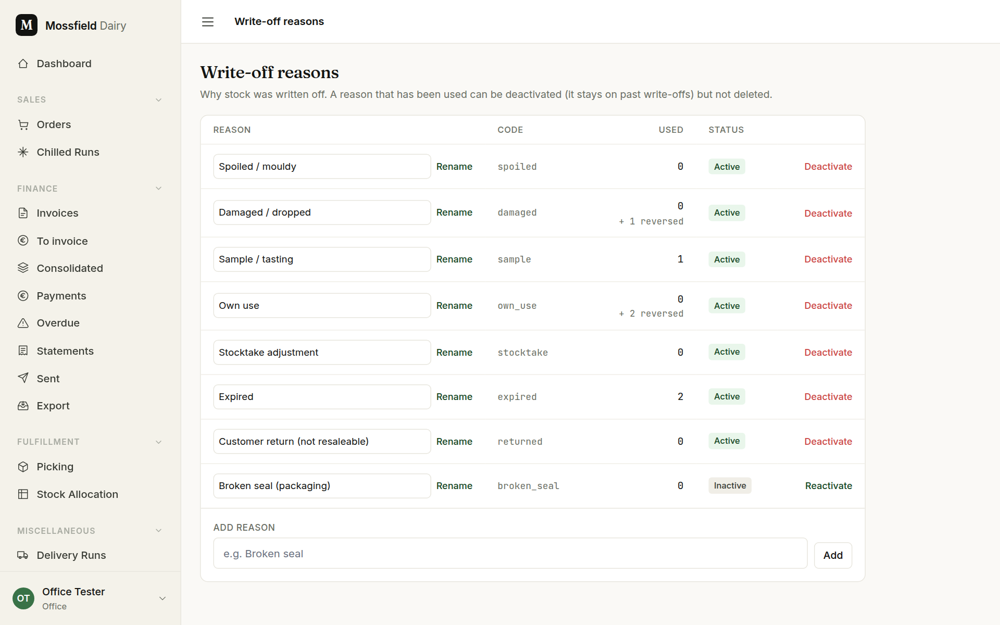

# Stock, products and write-offs

For the office and the floor. Everyone can read the stock overview and the product list; the office changes products and the write-off reasons.

## The stock overview

Open **Stock** in the sidebar. There is one card per type: Milk, Yoghurt, Cheese.

- Each row is one variant from one batch, with its batch code, and the oldest batch comes first: the order stock is used in.
- The picture fills by state. Each figure on the right is labelled:
  - **Available**: free to sell.
  - **Allocated**: reserved for an order, not yet picked.
  - **Sold**: gone out on orders.
  - **Written off**: lost (see *Write-offs* below).
  - Cheese wheels add **Maturing** (held back to become Mature cheese) and **Cut** (made into vacuum packs).
  - Cheese that has not reached its ready date shows as **Not ready**: counted, but not for sale yet and not in the value.
- Milk and yoghurt rows also say how many full cases and loose units that is, and show the expiry date.
- Only batches that are active and not expired are counted. When expired batches still hold stock, the card says so ("3 expired batches still hold 8,940 units — see Batches"). They are cleared by writing them off from the batch page; see [Production](production.md).
- *Total stock value* at the top is shown to the office only, not the floor: what the available stock is worth at list prices.

## Products and variants

Open **Products**. Products are grouped by type; each product lists its variants (sizes and packs).

- The *Stock* column is free stock: what can still be sold, after reservations and maturing holds, in batches that have not expired. It is the same figure the order screens, the run sheet and the online shop use.
- The *Price* column is shown to the office only.
- **View** opens a product with its variants and its recent batches, beside the list of the other products.

**Add a variant**: **Add variant** on the product. **Duplicate** on an existing variant opens the same form filled in from it, which is quicker for a similar size.

- **Variant name**, **Size** and **Unit** describe it: "1L Bottle", "1L", "bottle".
- **Weight (kg)**: the weight of one unit. For variable-weight items it is the expected average weight.
- **Variable weight**: tick for cheese. Each unit is weighed when it is picked.
- **Priced by weight**: tick when the price is per kilogram. The order is then billed on the weight picked. Leave it off to sell at a fixed price per unit.
- **Weigh in bulk (single total)**: for vacuum packs. The picker enters one total weight for the line instead of one per unit. Only used when **Variable weight** is on.
- **Base price**: the list price, per unit or per kilogram. A customer can have their own price for a variant (see [Customers](customers.md) *(office)*).
- **Units per case**: how many go in a crate (16 for 1L bottles, 6 for yoghurt tubs). The run sheet and the stock overview count cases with it.
- **Active (available for orders)**: untick to stop selling a variant. It disappears from the order and run-sheet pickers but keeps its history.

A price change applies to new order lines only; lines already on orders keep the price they were entered at.

## Write-offs

Write-offs are recorded on the batch page; see [Production](production.md). Each one needs a reason, and the list of reasons is kept under **Write-off reasons** (office only).

- **Add**: type a new reason under *Add reason*.
- **Rename**: change the wording in the box and press **Rename**. Past write-offs show the new wording.
- **Deactivate**: stop offering a reason. A reason that has been used cannot be deleted, so it is deactivated instead; it stays on the write-offs that used it. **Reactivate** brings it back.
- *Used* counts the write-offs with that reason, with any reversed ones shown separately.
